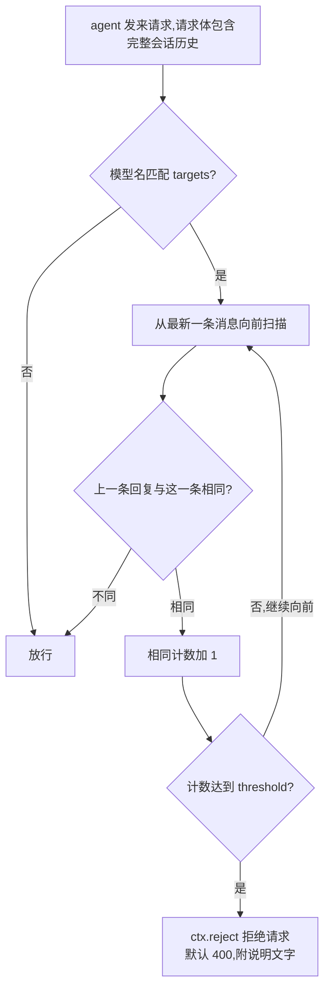

# loop-guard · LLM 死循环保护（magpie 网关中间件）

loop-guard 是一个 magpie 网关中间件。同一个会话里，模型连续返回内容相同的回复，次数达到阈值（默认 5 次）时，loop-guard 拒绝下一个请求。循环随之停止。

## 解决什么问题

模型在 agent 的工具调用循环里可能反复输出同一条回复：同一段文字、同一个工具调用、同样的参数。每重复一次，调用方就多支付一次费用。loop-guard 在请求发出前检查会话历史，统计“连续相同的回复”的数量，达到阈值后拒绝后续请求。

- 计数按会话独立。计数的唯一依据是请求体自带的会话历史。多个会话、子代理互不影响，不需要跨请求的共享表、锁或过期清理。
- 回复路径不经过本中间件。loop-guard 只注册 `onRequest`，不注册 `onEvent` 和 `onResponse`，流式回复不增加任何调用。
- 算不出来时放行。字符预算耗尽等一切“不确定”的情况都按不确定处理，请求照常发出。这与 magpie 中间件的失败语义（fail open）一致。

## 检测流程



1. 按 `ctx.protocol` 识别请求体里的轮次。识别不了的轮次跳过：
   - `anthropic`：轮次在 `messages` 里，`tool_result` 是工具结果
   - `chat`：轮次在 `messages` 里，`role` 为 `tool` 的消息是工具结果
   - `responses`：轮次在 `input` 数组里，相邻的 `message`、`function_call`、`reasoning` 合并为一条回复
   - `gemini`：轮次在 `contents` 里，`functionResponse` 是工具结果
2. 从最新一条消息向前扫描。助手回复去掉易变字段后比较内容；工具结果跳过；用户发言默认跳过，`stopOnUser` 为 `true` 时在此停止。遇到第一条不同的回复即停止扫描。
3. 相同回复的连续数量达到 `threshold` 时，调用 `ctx.reject` 拒绝请求。历史里最新一条回复就是模型上一次的输出。达到阈值时，被拒绝的是会产出下一次重复的请求：第 N 次重复已经发生，第 N+1 次不再发生。

说明：“同一条回复”的默认含义是整条消息逐字相同（去掉 `id`、`signature`、`usage` 等每轮必变的字段后）。剩余内容流式喂入两个 32 位哈希（FNV-1a 与 djb2 变体），两个值都相同才视为同一条回复。`scope` 设为 `"tools"` 时，只要工具调用相同即算同一条，不再要求文字一致。

## 安装

```sh
# 方式一:一条命令,在宿主机对运行中的官方 Docker 容器安装(可选卷映射方式)
curl -fsSL https://raw.githubusercontent.com/StrayDragon/magpie-loop-guard/main/deploy/install-remote.sh -o install-remote.sh
bash install-remote.sh

# 方式二:本地文件夹,即装即用
magpie plugin add ./magpie-loop-guard

# 方式三:从 GitHub 安装
magpie plugin add github:StrayDragon/magpie-loop-guard

magpie plugin    # 确认列表里有 loop-guard(Gateway middleware)
```

也可以在应用里操作：Plugins → Add a plugin → 选择文件夹。

**配置则生效**：本插件遵循白名单约定——写了的选项才生效，不写任何 options 就不拦截。Options 编辑器会预填建议配置（`targets: ["*"]`，保护全部模型，阈值 5），保存一次即对全部模型生效。

## 配置

选项保存在 plugins.json 里该插件的 `options`。修改入口：应用里 Plugins → Installed → 该中间件的 Options 按钮（JSON 编辑器），或命令行：

```sh
magpie plugin options loop-guard '{…}'
```

### 按模型组配置（models）

顶层字段是默认值；`models` 是一个规则数组，按书写顺序匹配请求的模型名，**首个命中的规则生效**。规则里只写要改的字段，其余继承顶层。

`targets`（任何一层）的语义固定：**未填 = 全部模型；`[]` = 不保护任何模型**。所以“只保护列出的模型”的写法是顶层 `targets: []` 加 `models` 规则。`agents` 同理。

推荐的起步配置——只保护 fusionxparks 供应商，重复 5 次熔断，忽略叙述差异：

```json
{
  "targets": [],
  "models": [
    {
      "targets": ["fusionxparks/*"],
      "threshold": 5,
      "scope": "tools",
      "ignore": ["description"]
    }
  ]
}
```

多组模型、各自阈值与模式：

```json
{
  "targets": [],
  "models": [
    { "targets": ["fusionxparks/*"], "threshold": 5, "scope": "tools", "ignore": ["description"] },
    { "targets": ["deepseek/*"], "threshold": 3 },
    { "targets": ["/^anthropic\\/claude-opus/"], "mode": "log" }
  ]
}
```

### 全部选项

| 选项 | 默认值 | 含义 |
| --- | --- | --- |
| `models` | 未填 | 规则数组，按序首个命中生效，规则自带 `targets`（未写继承顶层——顶层也未写时该规则不保护任何模型）。规则可用的字段与顶层相同（`targets`、`threshold`、`scope`、`mode`、`status`、`message`、`scan`、`maxChars`、`stopOnUser`、`ignore`），未写的继承顶层 |
| `targets` | 未写 | 保护对象名单：未写/`null`/`""` = 不保护任何模型；`[]` = 保护全部；`["模式", …]` = 只保护匹配的模型。匹配请求的模型名（`ctx.model`），写法为大小写不敏感的 `*` 通配（`"deepseek/*"`、`"*/deepseek-chat"`、完整名称）或 `/正则/`（区分大小写，与 model-map 的 `/pattern/` 惯例一致） |
| `agents` | 未写 | 收窄范围：未写/`null`/`""`/`[]` = 所有 agent 都在范围内；`["claude-code"]` = 仅匹配的 agent |
| `threshold` | `5` | 连续相同回复达到这个数量后，拒绝后续请求；低于 2 的值按 2 处理 |
| `scope` | 未填 = 全部参与 | 选择比较回复的哪些方面，数组任选：`"text"`（文字）、`"thinking"`（思考）、`"tools"`（工具调用名称与参数），顺序无关。兼容旧写法：未填或 `"full"` 等于三项全选，`"tools"` 等于 `["tools"]`；`[]` 表示该规则永不触发，即完全放行。chat 与 responses 的工具参数是 JSON 字符串，比较前会先解析，`ignore` 对参数内部生效 |

`scope` 有两条固定规则。规则一：回复里不含所选方面时，回退为全文比较，两条不同的回复不会因“没得比”被判为同一条。规则二（示例）：`["text"]` 忽略工具参数的变化，适合参数带自增计数器的循环；`["text","tools"]` 忽略思考文本的变化，适合思考每轮都改写的循环。
| `ignore` | `[]` | 在默认易变字段表之外，比较时额外忽略的字段名；顶层与规则的并集。chat 与 responses 的工具参数是 JSON 字符串，比较前会先解析，`ignore` 对参数内部生效 |
| `status` | `400` | 拒绝时返回的 HTTP 状态码。不用 429：多数 agent 会对 429 自动退避重试，与打断循环的目的相反 |
| `message` | 内置文案 | 自定义拒绝说明；默认文案写明次数与处理办法 |
| `mode` | `"reject"` | `"log"` 表示只记录不拒绝。首次使用宜先观察几天日志，确认无误伤后改回 `"reject"` |
| `scan` | `500` | 最多向前检查多少条消息；超出上限的消息不参与计数 |
| `maxChars` | `4000000` | 参与比较的字符总量上限，超出按“不确定”放行 |
| `stopOnUser` | `false` | `true` 表示向前检查遇到用户发言就停止计数，计数范围更保守 |

示例——DeepSeek 重复 3 次就拒绝，先只记录：

```sh
magpie plugin options loop-guard '{"targets":["*/deepseek-chat"],"threshold":3,"mode":"log"}'
```

### 动态修改配置

选项从下一个请求开始生效，不需要重启 magpie 或容器。网关每隔约 1 秒检查一次 plugins.json 与中间件文件，发现变化后重新装载。

- 网页界面：Plugins → Installed → loop-guard 卡片 → Options，在 JSON 编辑器里修改。
- 命令行：`magpie plugin options loop-guard '{…}'`。
- 开关与卸载在同一个卡片上；中间件文件更新也会被热重载。

## 被拒绝时的行为

agent 收到一个 400 错误，格式与该 agent 所用 API 的错误格式一致：

> loop-guard: the model has returned the same reply 5 times in a row in this session, so this request was stopped to break the loop. Start a new session or change the prompt, or raise "threshold" in this middleware's options.

解除办法：开新会话，或换一种提问。历史里最新一条回复一变，计数自动归零。也可以调高 `threshold` 或停用插件。

## 工作原理

- 四种 API 的轮次识别：`anthropic`（`messages`）、`chat`（`messages`）、`responses`（`input`）、`gemini`（`contents`）。识别不了的形状按“跳过”处理，不影响计数方向。
- 比较基于规范化内容：去掉易变字段后，按固定顺序喂入哈希，不构造中间字符串。
- 单条回复内部的复读（一次流式输出里反复输出同一句）不在检测范围内；本中间件处理的是“跨轮次的完整重复”。

边界与已知限制：

- 依赖客户端回传完整历史。主流 agent 都回传；只发送增量、不带历史的客户端检测不到。
- 历史被压缩后，更早的重复从请求体里消失，计数随之回落。压缩通常也会打断循环。
- 若模型的回复里还有其他每轮必变的字段，把这些字段名加进 `ignore`。

## 实测开销

测量环境是 moejs，即 magpie 运行中间件的引擎。请求体 133 KB、81 条消息、40 轮循环历史：单次 `onRequest` 约 1.5 ms，500 次平均 1.49–1.73 ms。钩子预算为 250 ms。没有循环的请求只比较 2 条回复即返回，低于这个数字。

## 在 Docker 里使用

官方 Docker 镜像（NAS、服务器）的用户用 `deploy/` 目录里的方案：

- `deploy/install-remote.sh`：一条命令安装，可选择卷映射方式（复制进 `/config` 卷，或宿主机目录挂载）。
- `deploy/docker-compose.yml` + `deploy/install-loop-guard.sh`：compose 方式，首次启动自动注入，之后不覆盖界面里改过的配置。

安装后的配置修改同样在网页界面（端口 3425）完成，热生效。完整说明见 [deploy/README.md](deploy/README.md)。

## 兼容性边界

插件对上游的依赖是显式列出的小集合：

- 对 magpie：1 个钩子 `onRequest`；5 个文档内的 ctx 字段 `protocol`、`model`、`agent`、`options`、`reject`。不使用 `onProvider`、`onEvent`、`onResponse`、`strategies`、`onUsage`，不读 `ctx.state`，不读任何请求头。
- 对请求体：从不改写。钩子只返回 `undefined`，唯一动作是 `ctx.reject`。请求体形状变化不会经由本插件弄坏请求，最坏结果是检测不到。
- 对 JS 引擎：语言下限为 ES5 加 `const`、`let`、箭头函数。文件内没有 `?.`、`??`、展开、模板字符串、类、`for...of`、`Map`、`Set`、`Symbol` 和正则；`Math.imul` 另带等价的 ES5 回退写法。不使用定时器、`fetch` 和存储。
- 对依赖：npm 包零依赖。`verify/` 只有 1 个 Go 依赖（moejs，精确固定版本），仅供开发与 CI 使用；magpie 运行时不加载 `verify/`。对 moejs API 的调用集中在 `verify/main.go` 一个文件里。
- 失败行为：插件加载失败或钩子异常时，magpie 按自身语义放行请求。网关不因本插件不可用。

## 测试与 CI

同一份 `cases.json`（56 个用例）在三种引擎里运行，CI 在每次推送时执行：

```sh
node test.mjs            # node(CI 里另有 22/24 矩阵)
bun test.mjs             # bun
cd verify && go run . -file ../loop-guard.middleware.js -cases ../cases.json   # moejs:生产同款引擎
cd verify && go run . -bench    # 大请求体的单次耗时基准
```

- `verify/` 是独立的 Go 验证器，依赖 magpie 同款的 [moejs](https://github.com/Calcium-Ion/moejs) 引擎，按网关的调用路径（`moejs.Compile` → `rt.Load` → `onRequest(body, ctx)`）运行同一份用例。
- 用例覆盖四种协议的工具循环，以及阈值边界：4 次相同回复放行，5 次拒绝。
- 用例覆盖 `models` 规则的首个命中、字段继承、`/正则/` 与无法编译模式的处理。
- 用例覆盖约定语义：不写、`null`、`""` 都不保护任何模型；`targets: []` 保护全部；`agents: []` 不收窄范围。
- 用例覆盖选项行为：`agents` 的匹配、`mode:"log"`、自定义 `status`、`message`、`threshold`、`stopOnUser`、`ignore` 深入工具参数内部、字符预算放行、无历史与空请求体。
- 用例覆盖 `scope` 的字符串与数组两种写法：改写叙述后 `"tools"` 与 `["tools"]` 仍计数，`"full"` 打断计数。
- 用例覆盖 `scope` 数组的边界：思考文本每轮变化时 `["text","tools"]` 仍计数；`["text"]` 忽略工具参数变化；`[]` 永不触发；全部未知条目回退全文比较；chat 的 reasoning_content 与 gemini 的 thought 按 `"thinking"` 方面处理。
- 用例覆盖 `"tools"` 的边界：没有工具调用的回复仍按全文比较。两条不同的文字回复不会被误判为同一条。
- 用例覆盖判定规则：只有易变字段不同的两条回复视为同一条；不同回复打断计数。
- CI 的 `moejs` 任务含一条成本红线：大请求体的单次钩子超过 25 ms 即失败。
- 部署资产也检查：`shellcheck` 与 `bash -n` 检查两个安装脚本，`docker compose config` 校验 compose 文件。

## 仓库结构

```
magpie-loop-guard/
├── loop-guard.middleware.js   # 中间件本体(magpie 加载的唯一文件)
├── package.json               # magpie.middleware 入口与示例选项
├── cases.json                 # 56 个用例(三种引擎共用)
├── test.mjs                   # node/bun 测试器
├── verify/                    # Go + moejs 验证器与基准(CI 的 moejs 任务)
├── deploy/                    # docker-compose、注入脚本、远端安装器
└── .github/workflows/ci.yml   # node 矩阵 / bun / moejs+成本红线 / 交叉编译 / 部署资产 lint
```

## 发布渠道

magpie 用户有三个入口能发现这个插件，按门槛从低到高：

1. GitHub 主题 `magpie-plugin`（已设置）：仓库出现在 magpie 的 Plugins → Discover → “Unofficial, on GitHub”列表，按 star 排序。
2. 发布到 npm：`package.json` 的 `repository` 已指向本仓库。发布后 magpie 从 npm 安装，新版本进入插件的更新提示。发布用 `magpie-loop-guard` 这个无 scope 名称；`@magpie-community/*` 属于官方社区组织。
3. 贡献进 [magpie-community/plugins](https://github.com/magpie-community/plugins)：放到它的 `packages/loop-guard`，包名改为 `@magpie-community/middleware-loop-guard`。通过审核后进入 Plugins → Discover → Gateway middleware 的 Ready-made 列表，并在每个 magpie 里自动更新。

本仓库的目录与用例格式已按第 3 条的约定准备（`cases.json` 与社区仓库 `scripts/middleware.mjs` 兼容）。

## License

MIT
